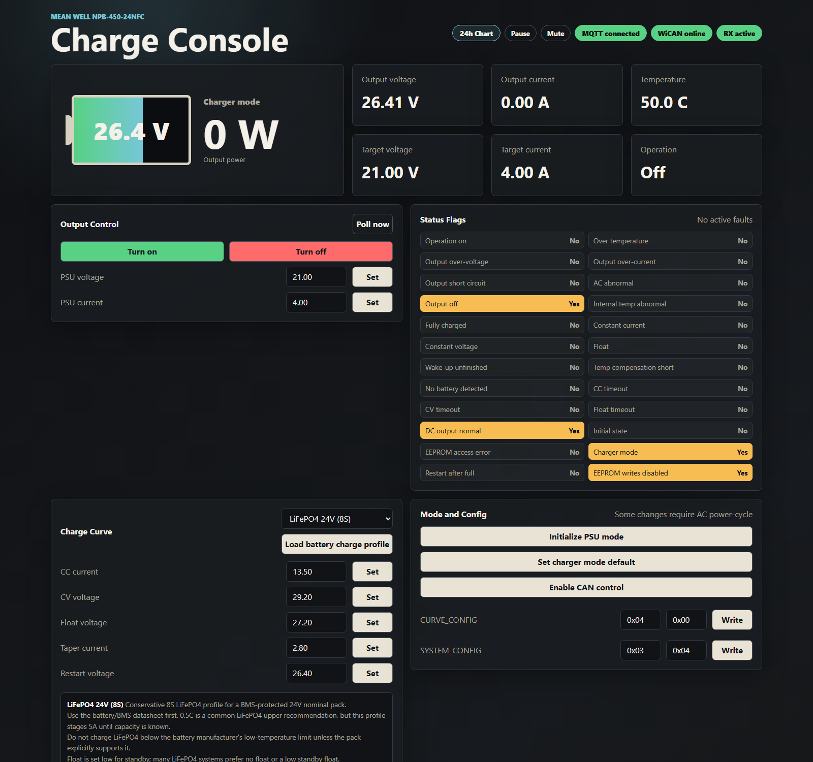
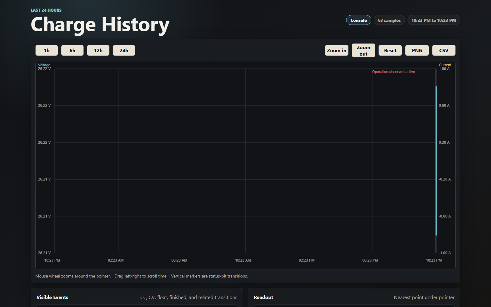

# NPB Monitor

Web monitor and control interface for a Mean Well NPB-450-24NFC charger on a LAN via a WiCAN MQTT-to-CAN bridge.

Defaults match the attached WiCAN configuration, except the app now runs its own MQTT broker:

- PC LAN IP / WiCAN MQTT target: `192.168.4.73`
- WiCAN IP observed in broker logs: `192.168.4.88`
- Web UI on the PC: `http://127.0.0.1:8088`
- Embedded MQTT broker listener: `0.0.0.0:1883`
- App MQTT client: `127.0.0.1:1883`
- TX topic: `wican/f412fa2e9d59/can/tx`
- RX topic: `wican/f412fa2e9d59/can/rx`
- Status topic: `wican/f412fa2e9d59/can/status`
- Charger CAN address: `0x00`

The charger protocol uses 250 kbps CAN 2.0B extended frames. Controller-to-charger CAN IDs are `0x000C01XX`, charger-to-controller IDs are `0x000C00XX`, and command/value bytes are sent little-endian. Writes do not generate callbacks, so the app polls status and readback registers after control actions.

## Screenshots





## Features

- Main console with charger mode, output voltage/current/power, temperature, target setpoints, status flags, notices, and recent frame traffic.
- Stale readback detection. Values gray out when they have not been refreshed by an incoming charger reply within the stale window.
- Visual and audible alerts for stale data, no battery, output-off while operation is on, AC abnormal, over-temperature, output over-voltage/current, short circuit, EEPROM error, and timeout faults.
- Mute button for audible alerts.
- Pause button for automatic data exchange. This stops polling/TX so the frame log can be inspected while MQTT remains connected.
- Session summary stats for this run: samples, energy estimate in Wh, peak voltage/current/power/temperature, event count, and start time.
- Raw CAN send/read controls plus a decoded-register table showing latest command, raw value, scaled value, age, and data bytes.
- 24-hour chart with zoom, pan/scroll, PNG export, CSV export, and annotated status transitions.
- Battery charge profiles for staging common 24V LiFePO4 and lead-acid charge-curve values.

## Run

```powershell
.\.venv\Scripts\Activate.ps1
pip install -e .
npb-monitor
```

Then open:

```text
http://127.0.0.1:8088
```

The 24-hour voltage/current chart is here:

```text
http://127.0.0.1:8088/history
```

The chart supports mouse-wheel zoom, drag-to-pan time scrolling, 1/6/12/24-hour range buttons, PNG export, and CSV export. Status-bit transitions such as constant current, constant voltage, float mode, output off, and fully charged are retained for the same 24-hour window and drawn as annotated vertical markers.

For normal use, run the startup script:

```powershell
.\run-monitor.ps1
```

Useful overrides:

```powershell
npb-monitor --http-host 0.0.0.0 --http-port 8088 --device-address 0
npb-monitor --no-embedded-mqtt --mqtt-host 192.168.4.73
npb-monitor --no-mqtt
```

When using the embedded broker, point WiCAN's MQTT URL to this PC's LAN IP, e.g. `192.168.4.73`, port `1883`, with no username/password unless you deliberately add external broker auth. The app itself connects to `127.0.0.1:1883`.

## MQTT broker

The app starts a pure-Python embedded MQTT broker by default. That removes the Mosquitto service dependency, but port `1883` must be free before startup.

```powershell
Get-NetTCPConnection -LocalPort 1883
```

If another process is listening, stop it or run the app with `--broker-port` and update WiCAN to match.

If WiCAN cannot connect after switching from Mosquitto to the embedded broker, keep the inbound firewall rule for TCP port `1883`; the listener is now `python.exe` instead of `mosquitto.exe`.

## Session logs

No SQLite or external database is used. Runtime samples are kept in memory for the live 24-hour chart. Session summaries are persisted as JSON files beside the code:

- `logs/current_session.json`: overwritten periodically while the server is running.
- `logs/sessions.jsonl`: one compact JSON summary appended when the app exits.

The `logs/` folder is ignored by git so charging sessions do not clutter commits.

## Tests

```powershell
.\.venv\Scripts\python.exe -m unittest discover -s tests
```

The tests verify CAN ID construction, little-endian command/write payloads, WiCAN MQTT frame JSON, and status/readback decoding.

To probe WiCAN/MQTT/CAN directly:

```powershell
npb-probe
```

This sends read-only requests to NPB addresses `0x00..0x03` and prints any raw `can/rx` replies. The NPB-450-24NFC tested here replied at address `0x00`.

## Command handling

Buttons and forms call `/api/control`. The server maps each action to a Mean Well command code, encodes command and value bytes little-endian, wraps the frame in WiCAN MQTT JSON, and publishes to the configured TX topic. Writes do not wait for a charger callback because the manual says there is no reply for writes; the app confirms changes by polling the corresponding readback/status registers.

Raw CAN is available through `/api/raw` and the Raw CAN panel. Named controls currently send:

- Operation: `0x0000`, one data byte `0x01` or `0x00`
- PSU voltage/current: `0x0020` / `0x0030`, factor `0.01`
- Charge curve CC/CV/float/taper/restart voltage: `0x00B0` / `0x00B1` / `0x00B2` / `0x00B3` / `0x00B9`, factor `0.01`
- Curve config: `0x00B4`, raw low/high bytes
- System config: `0x00C2`, raw low/high bytes

The `Enable CAN control` button sends `SYSTEM_CONFIG = low 0x03, high 0x04`, encoded on the wire as `[0xC2, 0x00, 0x03, 0x04]`. That sets the CAN-control low bit and also sets high-byte bit 10 to disable real-time EEPROM writes.

The decoded-register panel is fed by actual incoming CAN replies. If a register has not been read back recently, its age increases and the corresponding UI values turn stale/gray.

## Battery profiles

The Charge Curve panel has a battery profile selector and a `Load battery charge profile` button. Loading a profile only stages values in the input boxes; press `Set` on each row to write those values to the charger.

Starter profiles:

- LiFePO4 24V (8S): CC `5.0 A`, CV `28.4 V`, float `27.0 V`, taper `0.50 A`, restart `26.4 V`.
- Lead acid 24V: CC `4.0 A`, CV `28.8 V`, float `27.2 V`, taper `0.55 A`, restart `26.4 V`.

Charge current is the least universal value. For LiFePO4, Victron documentation commonly recommends about `0.5C` while also requiring the correct BMS/temperature limits. For lead-acid, Trojan and Rolls publish current/voltage guidance that varies by battery type, C20 capacity, temperature, and cycling pattern. Treat the staged current as a conservative starting point and use the battery datasheet when available.

## Mode-change timing

The manual distinguishes between configuration being written/read back and that configuration actually becoming active:

- `CURVE_CONFIG` (`0x00B4`) mode changes require an AC input power cycle. This includes switching charger mode/PSU mode through low-byte bit 7.
- Charger-curve parameter changes `CURVE_CC`, `CURVE_CV`, `CURVE_FV`, and `CURVE_TC` do not take effect immediately while the output/remote is on. Apply them by AC power-cycle, hardware remote on/off, or communication `OPERATION` off/on.
- `CHG_RST_VBAT` (`0x00B9`) is called out as not requiring AC restart or remote/operation cycling when its enable conditions are met.
- In PSU mode, `VOUT_SET` (`0x0020`) and `IOUT_SET` (`0x0030`) take effect immediately.

The web UI shows a notice banner after commands that need one of these activation steps.
