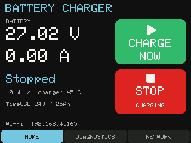

# CoreS3-SE direct CAN controller

Standalone firmware for an M5Stack CoreS3-SE, Base DIN and isolated Unit CAN U085, connected to a Mean Well NPB-450-24NFC at address 0. The original Python/WiCAN/MQTT application is unchanged.

## Current capabilities

- Native ESP32-S3 TWAI, GPIO17 TX / GPIO18 RX on blue Port C, 250 kbit/s, extended CAN. No MCP2515 or WiCAN is needed.
- A dedicated CAN task polls one of 16 registers every 180 ms and services receive traffic independently of HTTP, Wi-Fi and the display. Transmissions are single-shot; writes are never retried automatically.
- Landscape touchscreen with Home, Diagnostics and Network tabs. Home puts large green **Charge now** and red **Stop charging** buttons beside the live readings. Each register expires after 15 seconds; stale measurements become `--` rather than zero or frozen values.
- Responsive local dashboard: live readings, status, charge profiles, one-minute V/I history for up to 24 hours, raw traffic and configuration. History is bounded in RAM and clears on reboot.
- Authenticated charger controls: Operation on/off; PSU voltage/current; CC, CV, float, taper and restart settings; charger/PSU mode; EEPROM configuration; validated raw writes; manual reads, address scan and polling pause.
- Every write waits for an exact register readback. Readback confirms the register, not actual charging or activation of a mode change. Failed multi-step jobs may have applied earlier steps; inspect the live registers before retrying.
- Website controls start locked after every boot. The device key is required for each modifying HTTP request, even after unlocking. Unlocking requires fresh status and healthy CAN. The physical touchscreen has separate Operation-only authority and never unlocks website controls.
- Main-page **Charge now** reviews the current settings, requires battery/temperature confirmation, then verifies Operation OFF before sending ON. It preserves the curve settings. The shortcut is restricted to the user's TimeUSB 25.6V 25Ah pack: CC at most 5 A, CV 28.4-29.2 V, and a conservative float ceiling of 27 V. General controls remain available for other configurations.
- Wi-Fi credentials persist atomically in NVS. Station reconnect, password-protected fallback AP, mDNS and authenticated Wi-Fi firmware updates are implemented.

### Touchscreen charging (0.5.0)

Tap **Charge now** to review the current battery/curve settings and confirm that the connected battery is warm (0-50 C). After releasing that tap, hold **HOLD TO START** for two seconds. The screen clears to a large green progress ring and **Keep holding...**. Releasing early, moving outside the hold area or adding another finger cancels the gesture. The confirmation expires after 30 seconds. The charger settings, faults, CAN health and required AC-cycle acknowledgment are rechecked before starting.

**Stop charging** takes one tap, works with the website locked, and takes priority over queued commands, discarding any unsent ON in a start sequence. It still needs a functioning CAN connection; it is not a hardware emergency disconnect. The screen says **Stopping...** while checking readback and only shows **Stopped** with fresh Operation OFF and negligible current. It reports a failed stop instead of claiming success.

This remains a manually confirmed start. The charger temperature is not battery temperature; there is no automatic cold-battery protection or unattended maintenance mode. Children should ask an adult if unsure whether the battery is warm or if the screen reports a problem.



## Hardware

| Connection | Assignment |
|---|---|
| Base DIN input | 12 V through the DIN base's intended power input |
| Unit CAN Grove | Blue Port C: GND, +5 V, GPIO17 TX, GPIO18 RX |
| Charger CAN | H to pin 11, L to pin 12; verify connector numbering/orientation |
| Charger hardware enable | Remote ON/OFF is independent of CAN Operation; see manufacturer's pin 7/8 instructions |

Never feed 12 V into a Grove 5 V pin. The installed adapter is **Unit CAN**, not COMMU. COMMU uses an MCP2515 and needs different firmware. Use termination appropriate to the bus topology; the user's successful initial setup used one 150-ohm resistor with roughly six inches of wire. That observation is not a replacement for the manufacturer's termination guidance.

The controller request ID is `0x000C0100 | address`, and the charger response ID is `0x000C0000 | address`. Commands and values are little-endian. Poll requests have two data bytes. Operation writes have three; supported parameter writes have four.

## Build and install

Verified toolchain: PlatformIO Core 6.1.19, `espressif32@7.0.1`, M5Unified/M5GFX 0.3.0. The board has 16 MB flash and two OTA application slots.

```powershell
cd C:\repos\npb-monitor\firmware\cores3se
pio run -e cores3se
pio test -e host
```

The host test environment uses `windows_x86@1.2.0`; it does not flash the connected board. Tests cover frame validation, scaling, per-register staleness, rollover, flags, limits, charge review guards, dependent voltage limits and bounded history.

On this PC, the working `pio` is installed under Python314. The separate `platformio.exe` in `.platformio\penv` was broken during bring-up. Use the working `pio` command above.

For an initial USB install:

```powershell
pio run -e cores3se -t upload --upload-port COM3
python tools/capture_serial.py --port COM3 --seconds 20 --output boot.log
```

Confirm the USB port on a different PC. The actual board was detected as an ESP32-S3 on COM3; it is now in the garage and updated over Wi-Fi.

Before an initial build, copy `include/secrets.example.h` to `include/secrets.h` and fill in quoted, case-sensitive credentials. Generate a device key in `include/device_token.h`:

```python
from pathlib import Path
import secrets
path = Path('include/device_token.h')
if not path.exists():
    path.write_text('#pragma once\n#define DEVICE_TOKEN "' + secrets.token_hex(24) + '"\n')
```

Both files are excluded from Git. Do not overwrite the installed key accidentally. Without a configured key, modifying endpoints are disabled. Saved NVS Wi-Fi settings take precedence over the compiled seed settings.

For subsequent installs on the same trusted local network:

```powershell
python tools/wifi_update.py npb-monitor.local --check-auth
python tools/wifi_update.py npb-monitor.local
```

The uploader reads the local ignored key without printing it. These endpoints use local HTTP, not TLS; do not expose them publicly. An update reboots the controller, locks controls and clears RAM history. It does not send Operation OFF or stop a running charger.

## Network access

Open **http://npb-monitor.local/** or the IP shown on the touchscreen. The installed unit currently uses **192.168.4.165**, MAC **F4:12:FA:B9:3A:10**, on RoseHome. DHCP and mDNS both use `npb-monitor`; `/api/status.network.dhcp_hostname` reads back the actual STA interface hostname. A router's cached display name/nickname is separate from mDNS.

If station connection fails, the fallback AP is `NPB-Monitor` at **192.168.8.1**. Its persistent random password and the device key appear on the touchscreen Network tab. Wi-Fi credentials can be changed from the website's Configuration tab with that key.

During testing, this PC's Tailscale subnet route intercepted its local 192.168.4.0/22 network. A temporary ActiveStore host route for 192.168.4.165 through Ethernet interface 4 restored direct access. It disappears on PC reboot; recheck routing before blaming the firmware if access later fails. Tailscale itself was left enabled.

## Control semantics

Use Controls to enter the key, unlock, change one setting and inspect the command result. Profile selection only stages values; it sends no CAN commands. The normal poller never enables output or changes configuration on boot.

Charge now starts the charger's configured cycle; it does not add an independent end-of-charge cutoff. NPB-450NFC two/three-stage selection is configured through the manufacturer's NFC app, not these CAN controls. Use Stop charging when the supervised session is finished. Do not leave charging enabled through freezing conditions.

Model-specific limits come from the Mean Well manual, printed pages 61-64: PSU and charge CC current 2.7-13.5 A, voltage settings 21-42 V, taper 0.27-4.05 A, and float no higher than CV. These correct some minima in the original desktop UI; the desktop source is preserved.

Mode/configuration writes to `0x00B4` require a manual **charger AC** power cycle. The warning survives controller restarts and OTA. Acknowledgment is a user confirmation, not automatic proof that AC was cycled. Curve writes can require an intentional Operation off/on cycle; PSU setpoints take effect immediately in PSU mode. EEPROM-disabled parameter writes may not survive charger power loss.

Raw requests are intentionally restricted to known reads and validated writes. Reserved system bits, malformed bytes, wrong IDs, out-of-range values and unauthenticated writes are rejected. Explicit Operation OFF can be attempted with stale readings if controls were already unlocked; receipt still cannot be guaranteed if the CAN link is broken.

## API

GET: `/api/status`, `/api/history`, `/api/traffic`, `/api/config`. Status includes the physical display page, touch count, hold/review state and last local command ID.

GET `/api/screen.bmp` requires `X-NPB-Token` and returns a read-only 320x240 framebuffer screenshot. The Network page is blacked out to keep its device key and AP password private. `python tools/capture_screen.py npb-monitor.local screen.bmp` saves a capture; `tools/watch_touch.py` records physical-touch observations without sending commands.

POST requires the `X-NPB-Token` header: `/api/control`, `/api/raw`, `/api/config`, `/api/firmware` (multipart firmware file). Control/config requests use URL-encoded form fields. A queued command returns HTTP 202 and a job ID; follow `/api/status.control` until `verified` or `failed`. Manual read jobs report `reads_sent`, not write verification.

`tools/check_controls.py HOST --read --output PATH` verifies authentication/validation and sends a manual **read only**. It leaves controls locked and polling enabled. `--expect-stale` additionally checks missing measurements and refusal to unlock while disconnected.

`tools/test_charge_cycle.py` is an explicitly supervised hardware test that can start charging. Its required flag confirms a connected, warm TimeUSB battery; it validates the existing 5 A / 28.4 V curve, tests a short Operation cycle, then requests OFF and verifies output status. Do not include it in unattended CI.

## Long-term care and remaining hardware

The garage can freeze and the installed system has no battery temperature sensor. Internal charger temperature is not battery temperature. Unattended automatic recharge is therefore **not enabled**. A future standby policy needs battery temperature protection before enabling threshold-based recharge. The NPB supports a built-in restart threshold; readback of that configuration alone does not prove it is active.

The requested winter storage mode would reduce stored energy, then stop. This charger cannot discharge, and its current measurement does not measure discharge through the toy. Automatic storage preparation needs a controlled discharge load, an independent battery current/charge monitor and battery-temperature protection. Until then, use the toy/external load according to the battery's storage guidance and stop charging manually. The web page explains both paths; neither is presented as implemented automatic maintenance.

No AC relay/contactor control is implemented. No MQTT broker/client is required for standalone operation. If integration is later needed, prefer an optional publisher to an existing broker in a separate task with bounded queues; CAN and the display must continue without Wi-Fi/MQTT. PC session logs, CSV export and persistent history have not yet been ported.

See [VALIDATION.md](VALIDATION.md) for measured hardware results and remaining checks.

## References

- [M5Stack CoreS3-SE](https://docs.m5stack.com/en/core/CoreS3-SE)
- [M5Stack isolated Unit CAN](https://docs.m5stack.com/en/unit/Unit_CAN)
- [Mean Well NPB/NPP manual](https://www.meanwell.com/Upload/PDF/NPB,NPP-E.pdf)
- [TimeUSB 24V 25Ah specifications](https://www.timeusbpower.com/products/24v-25ah-deep-cycle-battery)
